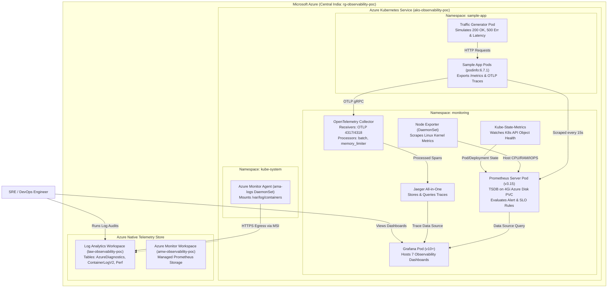

# Architecture and Telemetry Data Flow

## 1. System Architecture Diagram

---

## 2. Telemetry Pipeline Breakdown

### A. Metrics Pipeline (Prometheus & Grafana)
1. **Scraping:** Prometheus server runs with a 15-second `scrape_interval` and `evaluation_interval`.
2. **Targets:**
   - `kubernetes-service-endpoints`: Discovers pods with `prometheus.io/scrape: "true"` (e.g., `sample-app`, `kube-state-metrics`).
   - `kubernetes-nodes`: Gathers Kubelet runtime telemetry.
   - `kubernetes-nodes-cadvisor`: Captures container-level CPU/Memory utilization.
3. **Storage:** Locally persistent in a 4Gi Azure Managed Disk CSI Volume (`pvc.yaml`) mounted to `/data`.
4. **SLO Engine:** Background recording rules continuously materialize SLI availability and latency ratios into low-cost, pre-computed time-series.

### B. Distributed Tracing Pipeline (OTel & Jaeger)
1. **Instrumentation:** The sample application is configured with `OTEL_EXPORTER_OTLP_ENDPOINT: "http://otel-collector.monitoring.svc.cluster.local:4317"`.
2. **Span Ingestion:** The OpenTelemetry Collector receives spans via standard OTLP gRPC.
3. **Processing:**
   - `memory_limiter`: Drops or sheds load if container RAM exceeds 75% threshold.
   - `batch`: Groups trace spans in batches of 100 with a 1s timeout to optimize network IO.
4. **Export:** Pushes spans to Jaeger All-in-One (`jaeger:4317`) for indexing and real-time waterfall visualization.

### C. Logging & Auditing Pipeline (Azure Log Analytics)
1. **Data Plane:** The `ama-logs` DaemonSet reads all container standard outputs from `/var/log/containers` on the host node and streams them securely to `law-observability-poc`.
2. **Control Plane:** The `azurerm_monitor_diagnostic_setting` resource routes Kubernetes master components (`kube-apiserver`, `kube-audit`, `kube-scheduler`, `cloud-controller-manager`) directly to Log Analytics.
3. **Security:** Zero static credentials; all transmission authenticates via Azure Managed Service Identity (MSI).
